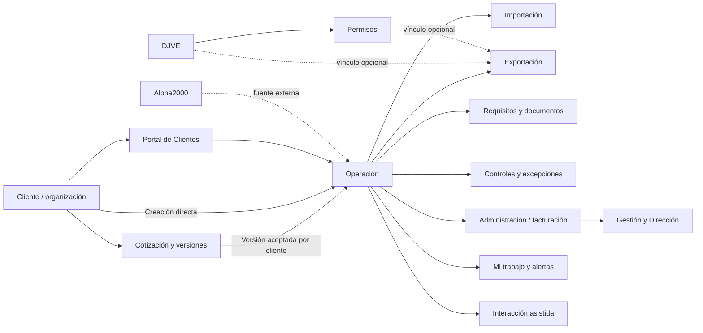

# Mapa de pantallas y recorridos del frontend

**Estado:** borrador de planificación integral para revisión humana
**Fecha:** 14/10/2026
**Base:** `main` con Etapas 0 y 1 aprobadas; Etapa 2 integrada y Under review; Etapa 3 implementada localmente y Under review

## Cómo usar este mapa

Este documento organiza experiencias, objetos y recorridos. No constituye una aprobación de rutas nuevas ni una orden de implementar pantallas. Las rutas marcadas como **aprobadas** son las conocidas del Application Shell de Etapa 1. Las rutas marcadas como **propuestas** sirven para discutir una arquitectura navegable y requieren definir su comportamiento antes de prototiparse. La [primera pasada integral](PLAN_IMPLEMENTACION.md#primera-pasada-integral-del-frontend) admite rutas propuestas reversibles con fixtures, sin cambiar las aprobadas del Shell; su uso operativo real exige validación funcional, permisos efectivos y contratos.

`/design-system` queda fuera del Application Shell y sigue siendo una referencia interna del sistema de diseño.

## Navegación aprobada y navegación propuesta

### Estructura aprobada por Etapa 1

La navegación interna aprobada conserva estas entradas y destinos:

- `Inicio` → `/inicio`
- `Mi trabajo` → `/mi-trabajo`
- `Operaciones` → `/operaciones`
  - `Importaciones` → `/operaciones?tipo=importacion`
  - `Exportaciones` → `/operaciones?tipo=exportacion`
- `Clientes` → `/clientes`
- `Cotizaciones` → `/cotizaciones`
- `Administración y Finanzas` → `/administracion`
- `Gestión` → `/gestion`
- `Configuración` → `/configuracion`

Interacción, responsive, onboarding y marcas del Shell: [especificación aprobada](screens/01-foundation-application-shell.md). Inicio y Mi trabajo son destinos consecutivos, separados sutilmente de dominios, sin grupos anidados. Operaciones abre la vista completa; no existe “Todas” redundante y sólo el destino seleccionado expone `aria-current="page"`.

### Principios para rutas futuras

- Las vistas de objeto deben conservar el objeto y su contexto en la URL.
- Los filtros, búsquedas, orden, agrupación y paginación se reflejan en URL cuando habilitan retorno, enlace o trabajo compartido.
- Documentos, controles, actividad y administración son capacidades contextuales del objeto; no se convierten automáticamente en entradas principales.
- Las experiencias de Portal tienen shell, identidad, permisos y lenguaje propios; no se mezclan con la navegación interna.
- La interacción asistida consulta servicios del producto y no crea un menú paralelo.

## Inventario de experiencias

La [política económica del alcance §7.2](../product/ALCANCE_FUNCIONAL.md#72-permisos-y-visibilidad) rige todas las experiencias, relaciones y canales: la responsabilidad operativa no concede honorarios. Las secciones de cotización/Administración y los datos aduaneros aplican capacidades distintas; los valores aduaneros necesarios y autorizados no habilitan costos internos ni márgenes.

Los estados y acciones de módulos pendientes son vocabulario de diseño, no catálogos de negocio aprobados. El estado de ruta no implica contenido implementado. [Etapa 2 §5](screens/02-inicio-mi-trabajo.md#5-contexto-de-navegación) define cómo contextualizar orígenes mientras no existan sus detalles.

| ID | Experiencia | Propósito | Ruta | Estado de ruta | Acciones principales | Objetos relacionados | Estados mínimos | Acceso / sensibilidad | Etapa |
|---|---|---|---|---|---|---|---|---|---|
| SHELL-01 | Application Shell | Proveer navegación, contexto, ayuda y atribución de marca. | `/inicio`, `/mi-trabajo`, etc. | **Aprobada** | Navegar, compactar, abrir drawer, ayuda/onboarding en Inicio. | Usuario, capacidad, ruta actual. | Carga, foco, drawer, permiso, degradado. | Interno; datos sensibles fuera del Shell. | 0-1 |
| DS-01 | Design System | Exhibir patrones visuales y estados reutilizables. | `/design-system` | **Aprobada y fuera del Shell** | Explorar componentes y fundamentos. | Componentes UI, marca. | Todos los estados de referencia. | Interno técnico. | 0 |
| HOME-01 | Inicio | Dar situación resumida y próximas acciones accionables. | `/inicio` | Aprobada; contenido posterior | Filtrar período, abrir trabajo, seguir alerta, retomar onboarding. | Operaciones, alertas, trabajo, fuentes. | Loading, vacío, parcial, stale, error, sin permiso. | Interno; sensibilidad por capacidad. | 2 |
| WORK-01 | Mi trabajo | Ordenar pendientes, bloqueos, vencimientos, asignaciones y trabajo sin operación. | `/mi-trabajo` | Aprobada; contenido posterior | Filtrar, ordenar, agrupar y ver contexto; abrir objeto sólo con destino útil. Escrituras posteriores. | Work item, operación, control, alerta. | Vacío, filtered-empty, bloqueado, vencido, error. | Interno; carga y datos operativos. | 2 |
| OPS-01 | Lista de operaciones | Encontrar operaciones y aplicar filtros compartibles. | `/operaciones` | Ruta aprobada; PR #8 integrado, CI requerido verde | Buscar, filtrar, ordenar, agrupar, seleccionar y abrir detalle común con retorno. | Operación, cliente, responsable, modalidad. | Cargado, vacío, filtered-empty, error, sin permiso, detalle ausente. | Operativo; sin totales económicos genéricos. Visibilidad según alcance §7.2. | 3 |
| OPS-02 | Lista filtrada por tipo | Trabajar específicamente Importación o Exportación preservando contexto. | `/operaciones?tipo=importacion` / `exportacion` | **Aprobada** como navegación filtrada | Cambiar filtros, agrupar, seleccionar, volver al contexto. | Operación, trámite, cliente. | Igual a OPS-01; filtros inválidos recuperables. | Misma confidencialidad que OPS-01. | 3, 7, 8 |
| OPS-03 | Detalle de operación | Mostrar identidad, situación, próxima acción y bloques comunes. | `/operaciones/[operationId]` | Propuesta; prototipo navegable, no ruta aprobada operativamente | Consultar identidad sintética, próxima referencia, procedencia y límites; volver conservando contexto. Edición, controles, actividad, documentos y Administración se habilitan sólo con reglas/fuentes definidas. | Operación, cliente, cotización, documentos, controles, trámites, handoff. | Draft, loading, read-only, bloqueado, conflicto, stale, error, sin permiso. | Interno; sensibilidad por sección. | 4 |
| OPS-04 | Alta guiada de operación | Crear una operación directa o desde una versión de cotización aceptada por el cliente evitando datos duplicados. | `/operaciones/nueva` | **Propuesta** | Elegir origen, cliente/tipo, contexto, responsabilidad, revisar y guardar. | Cotización aceptada, cliente, operación, requisitos. | Draft, saving, saved, validación, error recuperable, sin permiso. | Interno; datos comerciales/operativos. | 5 |
| OPS-05 | Control y próximos pasos | Resolver bloqueos, controles, hitos, vencimientos y excepciones del objeto. | Sección contextual en OPS-03; subruta aún no definida | **Propuesta** | Completar control, adjuntar evidencia, pedir excepción, reasignar, registrar motivo. | Control, documento, alerta, usuario, auditoría. | Pending, blocked, approved, rejected, conflict, audit. | Interno; acciones segregadas. | 4, 7, 8 |
| CLI-01 | Lista de clientes | Buscar organizaciones, clientes y contrapartes. | `/clientes` | Ruta aprobada; implementación sintética, revisión humana pendiente | Buscar por nombre/referencia, abrir ficha. Alta/edición no habilitada. | Cliente, organización, contacto, contraparte. | Cargado, vacío, filtered-empty, error, sin permiso. | Interno; datos maestros. | 6 |
| CLI-02 | Ficha de cliente | Consultar datos maestros y relaciones sin repetir información. | `/clientes/[clientId]` | **Propuesta; prototipo read-only Under review** | Consultar datos/contactos sintéticos, operaciones vinculadas; abrir la lista comercial con filtro por cliente y volver al contexto. Documentos y configuración pendientes. | Cliente, contactos, operaciones, cotizaciones relacionadas por filtro. | Read-only, stale, error, sin permiso, dato ausente. | Interno; datos de cliente; sin valores comerciales en ficha. | 6, 9 |
| CLI-03 | Configuración de cliente | Parametrizar requisitos y condiciones reutilizables, versionadas y auditadas. | `/clientes/[clientId]/configuracion` | **Propuesta** | Revisar, proponer, versionar, activar si se autoriza. | Cliente, regla, documento, modalidad. | Draft, pending approval, active, expired, error. | Capacidades específicas; sensibilidad comercial. | 6-8 |
| COT-01 | Lista de cotizaciones | Encontrar cotizaciones por cliente, estado, versión, vigencia y responsable. | `/cotizaciones` | Prototipo sintético Under review | Buscar, filtrar, abrir y crear; ordenamiento, vigencia y catálogos quedan pendientes. | Cotización, cliente, operación. | Loading, vacío, filtered-empty, error, sin permiso. | Interno; honorarios y precios; capacidad comercial simulada. | 9 |
| COT-02 | Detalle y versiones | Revisar líneas, cálculos, condiciones, aprobación interna, envío y respuesta del cliente. | `/cotizaciones/[quoteId]` | Prototipo sintético Under review | Crear versión; simular aprobación interna, envío y respuesta en sesión local; el alta de operación espera Etapa 5. | Cotización, versión, aprobación interna, envío, respuesta, cliente. | Draft, approved/sent/response demo, loading, error, sin permiso. | Sensible; capacidades mock, no seguridad real. | 9 |
| COT-03 | Alta/edición de cotización | Capturar datos y calcular de forma explicable. | `/cotizaciones/nueva`, `/cotizaciones/[quoteId]/editar` | Prototipo sintético Under review | Guardar borrador/versiones locales; cantidad × unitario, una moneda por versión; campos y reglas pendientes. | Cliente, servicio propuesto, moneda, versión. | Validation, saved local, error, no permission. | Sensible comercial/financiera; sólo fixture. | 9 |
| COT-04 | Conversión a operación | Crear una operación desde la versión aceptada por el cliente, conservando relación y origen. | Acción contextual en COT-02 | Pendiente de Etapa 5 | Acción deshabilitada con explicación hasta contar con el alta guiada; no crea una operación. | Cotización, versión aceptada, operación, cliente. | Client-accepted-only, future implementation. | Interno; capacidades de creación. | 5, 9 |
| IMP-01 | Workspace de Importación | Seguir clasificación, pre-embarque, preparación, doble control, oficialización, arribo, canal, liberación y cierre. | `/operaciones/[operationId]/importacion` | **Propuesta** | Completar etapa, consultar fuente, adjuntar documento y completar el control bloqueante con dos personas diferentes. | Operación, trámites, documentos, Alpha2000, controles. | Por etapa; bloqueado, stale, external error, read-only. | Interno; aduana y costos sensibles. | 7 |
| EXP-01 | Workspace de Exportación | Seguir instrucción, trámites, permisos, doble control, oficialización, carga, pase a Facturación, cumplido y post-embarque. | `/operaciones/[operationId]/exportacion` | **Propuesta** | Completar etapa, controlar permiso, adjuntar evidencia, completar doble control y entregar a Administración cuando esté lista para facturar. | Operación, DJVE opcional, permiso, documentos, certificados, factura. | Por etapa; bloqueado, vencido, external error; situación administrativa separada. | Interno; comercio exterior. | 8 |
| DJV-01 | DJVE y relaciones | Iniciar o consultar una DJVE como trámite propio y relacionarla con múltiples permisos u operaciones para uso operativo y administrativo. | `/tramites/djve` y `/tramites/djve/[djveId]` | **Propuesta** | Crear antes o después de la operación, buscar, vincular permisos/operaciones, controlar vigencia y abrir la salida de Facturación. | DJVE, permisos, operaciones, facturación. | Draft, active, expired, blocked, stale, error. | Interno; reglas y datos sensibles. | 8, 10 |
| DOC-01 | Documentos y custodia | Gestionar requisitos, versiones, archivo aduanero, originales exteriores y custodia física/digital. | Sección contextual; ruta global pendiente | **Propuesta** | Subir/recibir, revisar, marcar requisito, ubicar original, consultar historial. | Documento, requisito, operación, carpeta, usuario. | Required, pending, received, rejected, expired, archived, no permission. | Interno; portal según visibilidad. | 4, 7, 8, 10 |
| ADM-01 | Bandeja de Administración | Priorizar pendientes, listas para facturar, facturadas, cobradas y diferencias sin confundir estados operativos. | `/administracion` | Aprobada; contenido posterior | Filtrar cola, abrir operación, validar, devolver y registrar situación administrativa. | Operación, carpeta, cotización, gastos, factura, cobranza. | Loading, empty, ready to invoice, invoiced, collected, difference, blocked, stale, sin permiso. | Administración/Finanzas; honorarios y costos. | 10 |
| ADM-02 | Detalle administrativo | Validar honorarios, gastos, comprobantes, anticipos, rendiciones, facturación, cobranza y retorno a la operación. | `/administracion/[operationId]` | **Propuesta** | Revisar, registrar diferencia, preparar factura, registrar referencia y consultar Alpha2000. | Operación, cotización, gastos, comprobantes, factura, cobranza, Alpha2000. | Pending, ready to invoice, invoiced, collected, difference, external error, read-only; cumplido/post-embarque/cierre documental visibles por separado. | Capacidades financieras. | 10 |
| ADM-03 | Finanzas generales | Explorar fondos, pagos, caja, bancos, conciliaciones, costos e impuestos si se valida el alcance. | `/administracion/finanzas` | **Propuesta condicionada** | Consultar, conciliar, aprobar o exportar según definición futura. | Alpha2000, bancos, costos, impuestos. | Source unavailable, stale, partial, no permission. | Finanzas y fórmulas no confirmadas. | 10 |
| MGT-01 | Gestión y Dirección | Resumir operación, clientes, carga, alertas y datos económicos autorizados con drill-down. | `/gestion` | Aprobada; contenido posterior | Elegir período, filtrar, abrir fuente, exportar controladamente. | Operación, cliente, alertas, Alpha2000, `2025ABT.xlsx`. | Loading, stale, partial, no permission, source error. | Dirección; indicadores y fórmulas sensibles. | 11 |
| MGT-02 | Análisis de gestión | Profundizar productividad, clientes, evolución, facturación, cobranzas, costos y márgenes validados. | Secciones de `/gestion` | **Propuesta** | Cambiar dimensión/período, drill-down, exportar. | Métricas, fuentes, operación, cliente. | Sin datos, fórmula pendiente, stale, error. | Definiciones de negocio pendientes. | 11 |
| CFG-01 | Configuración | Separar general, catálogos, requisitos, reglas, documentos, capacidades, usuarios e integraciones. | `/configuracion` | Aprobada; contenido posterior | Consultar/editar según capacidad, versionar y auditar. | Identidad, reglas, integraciones. | Read-only, saving, conflict, external error. | Matriz de capacidades y gobernanza. | 6-10 |
| ALT-01 | Alertas y notificaciones | Resolver alertas accionables desde Inicio/Mi trabajo y conservar su objeto origen. | Centro contextual pendiente | **Propuesta** | Abrir objeto, posponer si se permite, marcar lectura. | Alerta, operación, control, canal. | Unread, read, blocked, expired, source error. | Taxonomía, canales y preferencias. | 2, 4, 11, 12 |
| INT-01 | Salud de integraciones | Mostrar fuente, última sincronización, error y acción posible para los frentes previstos por el alcance: Alpha2000 prioritario; M365/Interbanking según definición y ARCA directo sólo si se decide. No implica conectores disponibles. | `/configuracion/integraciones` | **Propuesta** | Consultar estado, reintentar si se autoriza, abrir evidencia. | Integración, fuente, sincronización, auditoría. | Connected, stale, degraded, failed, read-only. | Contratos y operaciones permitidas. | 7-13 |
| POR-01 | Portal: acceso | Invitar/activar/revocar identidad externa y aplicar visibilidad. | Separado del Shell; ruta de proveedor pendiente | **Propuesta** | Activar, recuperar, cerrar sesión, solicitar ayuda. | Cliente, usuario externo, capacidad. | Pending invite, active, revoked, error. | Proveedor de identidad y política. | 12 |
| POR-02 | Portal: inicio | Ver operaciones, hitos, pendientes y notificaciones autorizadas. | `/portal` | **Propuesta** | Abrir operación, revisar pendiente, pedir ayuda. | Operación, documento, alerta. | Loading, empty, partial, stale, no permission. | Datos visibles y lenguaje. | 12 |
| POR-03 | Portal: operación y documentos | Consultar estado y documentos compartidos; cargas futuras sólo si se aprueban. | `/portal/operaciones/[operationId]` | **Propuesta** | Abrir documento, descargar si se permite, cargar cuando esté validado. | Operación, documento, requisito, alerta. | Read-only, pending upload, review, rejected, error. | Acciones y seguridad. | 12 |
| AST-01 | Interacción asistida | Resolver consultas de lectura y mostrar fuente, frescura y límites. | Canal contextual, sin ruta principal | **Propuesta** | Consultar, abrir resultado, pedir confirmación para acción futura. | Mismos objetos y servicios. | No data, stale, ambiguous, permission denied, source error. | Casos iniciales y proveedor. | 13 |

### Clasificación de las 32 experiencias

La clasificación evita contar cada sección, diálogo o capacidad como una pantalla independiente:

- **Pantallas internas:** `HOME-01`, `OPS-01`, `OPS-02`, `OPS-03`, `OPS-04`, `CLI-01`, `CLI-02`, `COT-01`, `COT-02`, `COT-03`, `DJV-01`, `ADM-02`, `ADM-03`, `MGT-01`, `CFG-01`.
- **Bandejas operativas:** `WORK-01`, `ADM-01`.
- **Secciones de detalle o workspace:** `OPS-05`, `CLI-03`, `IMP-01`, `EXP-01`, `MGT-02`.
- **Acciones contextuales y diálogos:** `COT-04`; la resolución de excepciones se presenta dentro de `OPS-05`, sin ruta propia.
- **Capacidades transversales:** `SHELL-01`, `DOC-01`, `ALT-01`.
- **Experiencias técnicas internas:** `DS-01`, `INT-01`.
- **Experiencias externas:** `POR-01`, `POR-02`, `POR-03`, `AST-01`.

Esta taxonomía describe la composición propuesta. No aprueba rutas nuevas ni obliga a que cada ID sea una página independiente.

## Relaciones entre objetos

Estas relaciones son conceptuales. No fijan cardinalidades ni autorizan una API. Una DJVE puede existir antes de una operación y relacionarse con múltiples permisos u operaciones; también hay permisos sin DJVE. La misma información debe servir al control operativo y a Facturación. Las cardinalidades exactas y las reglas cuantitativas requieren validación.

## Recorridos completos

### J1 — Apertura directa o desde Cotización → Operación → Control → Administración → Dirección

La apertura tiene dos caminos. **Directa:** pedido/instrucción de cliente → alta guiada → responsabilidad, contexto y revisión → Operación (continuar desde paso 6). No exige una cotización nueva ni convierte aprobación interna en aceptación del cliente.

**Desde cotización aceptada:**

1. Se consulta o crea el cliente y se reutilizan datos maestros.
2. Se crea una cotización con líneas, moneda, condiciones y versión.
3. Se completa la aprobación interna antes de enviar la versión al cliente.
4. Se registra el envío y la aceptación o rechazo del cliente; estos hitos no son sinónimos de la aprobación interna.
5. Desde la versión aceptada se inicia la alta guiada de la operación, preservando origen y datos reutilizados.
6. Mi trabajo y el detalle muestran responsable, etapa, controles, documentos, alertas y próxima acción.
7. Los controles y excepciones conservan evidencia, motivo, autorización y auditoría.
8. Cuando la operación cumple el criterio validado para el pase, se entrega a Administración.
9. Administración valida honorarios, gastos, comprobantes y facturación; Alpha2000 conserva las funciones contables que correspondan.
10. Dirección consulta información validada con fuente, período, permisos y drill-down hasta la operación o el origen.

**Dependencias críticas:** ID operativo, cardinalidad versión aceptada→operaciones, matriz de capacidades, criterio de pase a Administración, Alpha2000 y fórmulas de Dirección.

### J2 — Importación completa

1. Solicitud del cliente y clasificación inicial.
2. Pre-embarque: requisitos, documentos y análisis.
3. Preparación: datos provisorios, costos y coordinación con Alpha2000.
4. Doble control bloqueante por dos personas diferentes antes de oficializar.
5. Arribo, oficialización, canal, liberación y seguimiento de fuentes externas.
6. Cierre documental, custodia y entrega a Administración.

**Estados:** por etapa, con pendientes, bloqueos, vencimientos, errores de fuente y read-only. El flujo debe admitir variaciones por cliente, país, puerto, modalidad y mercadería.

### J3 — Exportación completa

1. Instrucción del cliente y configuración de datos.
2. Trámites previos, permisos y DJVE relacionados cuando exista; la DJVE no es obligatoria para todo permiso.
3. Doble control bloqueante por dos personas diferentes antes de oficializar.
4. Oficialización y VEP cuando corresponda.
5. Carga, certificados, organismos y separación entre legajo aduanero y originales para exterior.
6. Pase a Facturación cuando cumpla su criterio, sin esperar cumplido ni post-embarque.
7. Continuidad de cumplido, post-embarque y cierre documental aunque la operación ya esté facturada.

**Dependencias:** relación DJVE→múltiples permisos/operaciones, reglas de vigencia y tolerancia, documentos por modalidad y cobertura aduanera de Alpha2000 y evaluación condicionada de MOA según el plan.

### J4 — DJVE para control operativo y Facturación

1. Iniciar o consultar la DJVE y su vigencia aunque todavía no exista una operación.
2. Relacionar múltiples permisos u operaciones sin exigir DJVE para cada permiso.
3. Mostrar cantidades declaradas/afectadas, vencimiento, avance, pendientes y diferencias con fuente y período; fórmula y tolerancias sujetas a validación.
4. Usar la misma información estructurada en el control operativo y en la salida para Facturación.
5. Entregar a Dirección sólo información cuyos cálculos y permisos estén validados.

El rango 90%-104% es una regla operativa observada en el relevamiento de DJVE de granos. No se generaliza a toda Exportación ni se convierte en cálculo o bloqueo hasta validar fórmula, contexto, vigencia, unidad, redondeo y excepciones.

### J5 — Cliente, configuración y primer trabajo

1. Alta o selección de cliente y contrapartes.
2. Configuración versionada de requisitos y condiciones reutilizables.
3. Creación de cotización u operación guiada.
4. Derivación de requisitos y tareas a Mi trabajo.
5. Confirmación de fuente de datos, capacidad requerida y siguiente acción.

### J6 — Excepción o demora hasta resolución

1. Una regla o fuente genera una alerta con objeto, motivo, severidad y vencimiento.
2. Mi trabajo prioriza la alerta y el detalle muestra el impacto.
3. La persona responsable corrige, adjunta evidencia o solicita excepción.
4. La excepción requiere motivo, capacidad, aprobación si aplica y auditoría.
5. El estado y la próxima acción se actualizan sin borrar el historial.

### J7 — Administración y Finanzas

1. Administración recibe la operación lista para facturar.
2. Valida cotización, honorarios, gastos, anticipos, comprobantes y carpeta.
3. Registra diferencias o prepara facturación según capacidad.
4. Registra la referencia de factura y la devuelve a Exportación; la operación puede seguir activa para cumplido, post-embarque y cierre documental.
5. Consulta facturación, cobranzas, pagos y cuentas en Alpha2000 sin replicar la contabilidad.
6. Mantiene distintas las situaciones lista para facturar, facturada, cobrada, cumplida, post-embarque y cerrada documentalmente.
7. Los flujos de fondos, bancos, costos, impuestos y conciliaciones se incorporan sólo tras validar alcance, fórmulas y responsables.

### J8 — Portal de Clientes

1. Se habilita una identidad externa con permisos y auditoría.
2. El cliente consulta operaciones, hitos, pendientes y documentos compartidos.
3. El sistema identifica origen y frescura cuando un dato sea externo.
4. Cargas o acciones del cliente se habilitan sólo después de validar reglas, revisión y seguridad.

### J9 — Interacción asistida

1. La persona consulta a través de un canal permitido.
2. El asistente usa servicios y permisos del producto.
3. La respuesta muestra fuente, fecha y límites; si el dato no es confiable, solicita revisión.
4. Las escrituras futuras requieren confirmación, idempotencia, autorización y auditoría.

### J10 — Procedencia y continuidad de información

ID histórico conservado; deja de representar una migración de COMEX360.

1. Se identifica la fuente original de cada campo/documento y, si corresponde, el intermediario autorizado.
2. Se informa actualización, dato pendiente, parcial, desactualizado, error y ausencia de permiso; no se simula conexión real.
3. ABT Comex resuelve documentación, antecedentes y relación operativa/administrativa con capacidades propias, preservando las funciones especializadas de Alpha2000. No exige datos o conectores del sistema reemplazado.
4. Los conflictos se muestran como conflictos recuperables, no como sobrescrituras silenciosas. El frontend demostrativo usa fixtures coherentes y no espera contratos externos para representar estos casos.

## Criterios compartidos

Estados de pantalla, responsive, permisos, frescura, patrones y referentes investigados: [Frontend Standard](FRONTEND_STANDARD.md). Estados de negocio y transiciones: [alcance](../product/ALCANCE_FUNCIONAL.md) y especificaciones particulares. No reinterpretar los ejemplos de la columna “Estados mínimos” como reglas aprobadas.

## Trazabilidad hacia especificaciones y pruebas

Cada necesidad conserva en la matriz su fuente, capacidad, regla y etapa. Esta tabla enlaza familias con procesos, experiencias y pruebas; no duplica sus reglas. Los estados de implementación se consultan en el [plan](PLAN_IMPLEMENTACION.md#estado-de-etapas), no se deducen del número de ruta.

| Necesidades de matriz | Experiencias | Recorridos | Especificación / pruebas y estado real |
|---|---|---|---|
| COV-001 a COV-012 | SHELL-01, DS-01; criterios transversales a las 32 experiencias | J1–J10 | [Shell](screens/01-foundation-application-shell.md), [pruebas existentes](../../apps/web/e2e/specs/application-shell.spec.ts); cobertura particular futura pendiente. |
| WRK-001 a WRK-005; OPE-002, OPE-005, OPE-006 | HOME-01, WORK-01, ALT-01 | J1, J5, J6, J7, J10 | [Inicio/Mi trabajo](screens/02-inicio-mi-trabajo.md#20-escenarios-de-prueba): implementación en `features/home`, `features/work`; unitarias, a11y y E2E; PR #7 integrado, revisión humana pendiente. |
| OPE-001 a OPE-005 | OPS-01, OPS-02, OPS-03, OPS-04, OPS-05 | J1, J2, J3, J6 | [Listado](screens/03-operaciones-listado.md) y [detalle](screens/04-operacion-detalle.md), `features/operations`; PR #8 integrado a `main`, CI requerido verde; alta y verticales siguen pendientes. Revisión humana integral pendiente. |
| CLI-001 a CLI-005 | CLI-01, CLI-02, CLI-03, POR-01 | J1, J5, J8 | [Clientes](screens/06-clientes.md), `features/clients`, pruebas unitarias/a11y/E2E; Etapa 6 implementada en modo demostrativo e integrada por PR #10, deployment READY; revisión humana pendiente. CLI-003, CLI-005 y relaciones de Cotizaciones/documentos siguen pendientes de sus etapas/definiciones. |
| COT-001 a COT-006 | COT-01, COT-02, COT-03, COT-04 | J1, J5 | [Cotizaciones](screens/09-cotizaciones.md), `features/quotes`, unitarias/componentes/a11y/E2E; implementación Etapa 9 en revisión técnica, conversión pendiente de Etapa 5. |
| IMP-001 a IMP-006 | IMP-01, OPS-05 | J2, J6, J7, J10 | Especificación/pruebas de Etapa 7 pendientes; representación del bloqueo en T02-04. |
| EXP-001 a EXP-007; DJV-001 a DJV-004 | EXP-01, DJV-01, OPS-05 | J3, J4, J6, J7, J10 | Especificaciones/pruebas de Etapa 8 pendientes; contexto/bloqueo en T02-02/T02-04. |
| DOC-001 a DOC-004; CTRL-001 a CTRL-003 | DOC-01, OPS-05, POR-03 | J1, J2, J3, J4, J6, J8 | Especificaciones de objeto/custodia y pruebas futuras pendientes; no confundir escenario con control implementado. |
| FIN-001 a FIN-009; ALP-005 a ALP-008 | ADM-01, ADM-02, ADM-03 | J3, J4, J7, J10 | Especificaciones/pruebas de Etapa 10 pendientes. |
| MGT-001 a MGT-005; REP-001 a REP-018 | MGT-01, MGT-02 | J1, J4, J7, J10 | Especificación/pruebas de Etapa 11 pendientes; definiciones métricas y fuentes sin validar. |
| CFG-001 a CFG-004 | CFG-01, CLI-03, INT-01 | J5, J10 | Especificaciones/pruebas pendientes en etapas consumidoras; no se crea motor/configurador universal. |
| ALT-001, ALT-002 | ALT-01, HOME-01, WORK-01 | J6, J8, J9 | T02-01/T02-04/T02-05 sólo contexto/alerta; notificación real diferida. |
| INT-001, INT-003 a INT-005; ALP-001 a ALP-009 | INT-01, IMP-01, EXP-01, ADM-02, MGT-01 | J10 y fuentes en J1–J9 | Relevamiento y pruebas de integración pendientes; T02-05 prueba representación mock. |
| INT-002 | DOC-01, OPS-03, ADM-02 — Capacidades propias, no pantalla del sistema histórico | J6, J7, J10 | Evidencia histórica de fragmentación/doble carga; cobertura en DOC-001 a DOC-004, FIN-002, OPE-003 y CTRL-003. Sin conector ni migración prevista. |
| INT-006 | Ninguna: depósito fiscal fuera de alcance | Ninguno | Sin etapa ni pruebas de producto previstas. |
| POR-001 a POR-003 | POR-01, POR-02, POR-03 | J8 | Especificaciones/pruebas de Etapa 12 pendientes. |
| AST-001 a AST-003 | AST-01 | J9 | Especificación/pruebas de Etapa 13 pendientes. |

## Decisiones que deben cerrarse antes de implementar las rutas propuestas

1. Catálogo de estados, ID operativo, cardinalidades y transiciones.
2. Capacidad/permisos, sensibilidad y segregación de doble control.
3. Requisitos documentales, custodia y criterio de carpeta completa.
4. Contratos Alpha2000 campo a campo y cobertura de cumplidos/MOA por la vía prioritaria; ARCA directo sólo si se justifica. No bloquean fixtures demostrativos.
5. Fórmulas y fuentes de Dirección, incluyendo los 18 bloques inventariados de `2025ABT.xlsx`.
6. Identidad, visibilidad y acciones del Portal.
7. Casos y canal de interacción asistida.

Este mapa registra la integración de Etapa 2 y el trabajo en curso de Etapa 3; no supone aprobación humana ni de negocio. Las rutas de objeto propuestas conservan su estado hasta que cada etapa implemente un destino útil.
