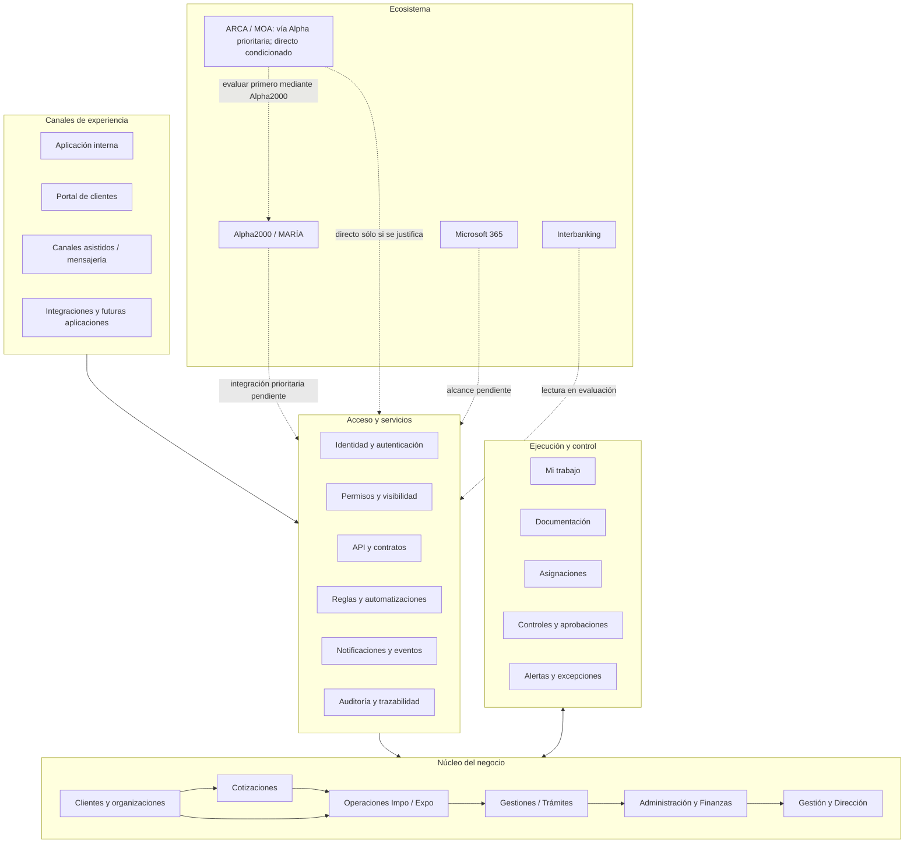
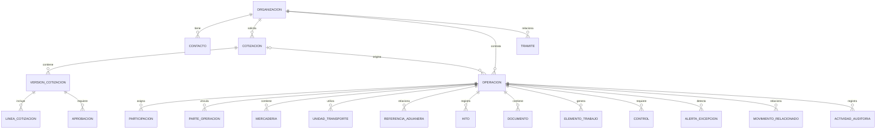

# ABT Comex — Alcance funcional

> Documento vivo · Última sincronización con el documento funcional de Drive: 09/10/2026
>
> Fuente de trabajo para implementación: este archivo.
> Documento visual y de validación con negocio: [Alcance funcional — ABT Comex](https://docs.google.com/document/d/1xMiET79fBh0_B3mPHj7yylq0capL-tkMqFJBVBJcRAQ/edit)
>
> Sincronización pendiente: §7.2 (confidencialidad) y §§3, 8, 10 y 11 (estrategia de integraciones y exclusión de COMEX360), decisiones internas del responsable del proyecto del 14/10/2026. Validación formal y capacidades con ABT pendientes; Drive no fue modificado.

## Propósito

Este documento define **qué producto se construirá**. No reemplaza los requerimientos detallados, los flujos AS IS / TO BE ni la especificación funcional de frontend.

Su función es:

- consolidar el alcance funcional;
- evitar que diseño o implementación amplíen silenciosamente el producto;
- dar contexto estable a personas, agentes y herramientas que trabajen en el repositorio;
- mantener separadas las decisiones confirmadas, recomendadas, en evaluación y fuera de alcance.

## Estado de una capacidad

| Estado | Significado |
|---|---|
| **Incluido** | Forma parte de la solución prevista. |
| **Incluido por etapas** | Forma parte del producto, pero se habilitará progresivamente. |
| **Recomendado — sujeto a validación** | Tiene valor identificado, pero necesita validación formal antes de profundizarse. |
| **En evaluación** | Depende de factibilidad, fuente de datos, API, costo o decisión de negocio. |
| **Pendiente de definición** | El frente tiene lugar en la arquitectura, pero faltan decisiones funcionales. |
| **Fuera de alcance** | No se desarrollará en esta etapa. |

---

## 1. Definición del producto

ABT Comex será una plataforma de gestión empresarial centrada en la **Operación completa de Importación y Exportación**.

El sistema estructurará información y documentación, asignará responsables, incorporará reglas para prevenir errores, gestionará controles y excepciones, mantendrá trazabilidad y generará información de gestión. Se integrará con los sistemas especializados que deben permanecer, reemplazará progresivamente herramientas paralelas y expondrá sus capacidades mediante servicios comunes para distintos canales autorizados.

### Objetivos

- Gestionar de punta a punta las operaciones de Importación y Exportación.
- Reducir doble carga, errores de tipeo, retrabajos y dependencias personales.
- Centralizar estados, responsables, documentos, controles, pendientes y excepciones.
- Reutilizar datos de clientes, cotizaciones, antecedentes e integraciones.
- Protocolizar el trabajo sin imponer un flujo rígido que desconozca la variabilidad real.
- Conectar Operaciones con Administración, Finanzas y Dirección.
- Convertir el avance operativo en información de gestión confiable.
- Preparar una base sólida para Portal de clientes, APIs, automatizaciones y canales asistidos por modelos de lenguaje.

### Frontera del producto

ABT Comex no será:

- una reproducción de los Excel actuales;
- una colección de pantallas aisladas;
- un ERP contable generalista;
- un gestor de proyectos genérico;
- una capa de frontend con reglas críticas implementadas sólo en el navegador.

Será una solución especializada para ABT, suficientemente robusta para evolucionar sin trasladar complejidad innecesaria al usuario.

---

## 2. Principios funcionales

| Principio | Aplicación en ABT |
|---|---|
| **Operación como núcleo** | La Importación o Exportación completa es el objeto principal. |
| **Dato ingresado una vez** | Se reutiliza información de Cliente, Cotización, antecedentes, Alpha2000 u otra fuente confiable. |
| **Prevenir antes que corregir** | Calcular, restringir y validar para reducir errores antes de que lleguen al proceso. |
| **Flexibilidad controlada** | Núcleo común con reglas configurables por cliente, modalidad, mercadería, organismo y contexto. |
| **Excepciones visibles** | Demoras, vencimientos, faltantes, diferencias y bloqueos son protagonistas. |
| **Trazabilidad automática** | Las acciones relevantes generan actividad y auditoría. |
| **Seguridad por necesidad** | Relación con un dato no equivale a permiso para ver información sensible. |
| **Integrar, no duplicar** | Los sistemas especializados conservan sus responsabilidades. |
| **Configuración antes que código especial** | Las diferencias repetitivas no se resuelven con condicionales aislados por cliente. |
| **Indicador a acción** | Todo KPI o alerta permite llegar a los registros que lo explican. |
| **Seguridad uniforme entre canales** | Aplicación interna, Portal, integraciones y canales asistidos comparten reglas, permisos y auditoría. |
| **Proveedor agnóstico** | La lógica del negocio no depende de una marca, modelo de lenguaje o canal concreto. |
| **Implementación gradual** | La arquitectura se prepara desde el inicio; las capacidades se habilitan según valor validado. |

---

## 3. Arquitectura funcional

La arquitectura se organiza en una capa de experiencia y cuatro capas internas.



### Criterio de diseño

La complejidad correcta vive debajo del sistema, no en el menú. Documentos, alertas, aprobaciones, DJVE, proveedores o auditoría no necesitan convertirse automáticamente en módulos principales.

---

## 4. Dominios del producto

### 4.1 Datos maestros

**Incluido**

- Clientes como entidad maestra visible de primer nivel.
- Proveedores y otras contrapartes como información estructurada reutilizable.
- Contactos y direcciones vinculados a organizaciones.
- Usuarios internos, usuarios externos y equipos.
- Servicios y conceptos cobrables.
- Catálogos: monedas, unidades, países, aduanas, modalidades, tipos documentales y otros valores controlados.

A nivel técnico puede existir una entidad general `Organización / Parte` con distintos roles. La interfaz utilizará términos naturales para ABT: Cliente, Proveedor, Forwarder, Transportista, etc.

### 4.2 Cotizaciones

**Incluido**

- Estructura reutilizable y parametrizable.
- Versionado de líneas, cantidades, unidades, precios, condiciones y observaciones.
- Cálculos automáticos: cantidad × precio unitario, descuentos, adicionales y totales.
- Aprobación obligatoria por un usuario autorizado antes del envío.
- Registro de creación, modificación, aprobación, envío y aceptación o rechazo.
- Creación explícita de una Operación desde la versión aceptada, reutilizando datos aprobados.

Una Operación también puede crearse directamente. La cardinalidad definitiva Cotización → Operaciones debe confirmarse.

### 4.3 Operaciones

**Incluido · núcleo del sistema**

Una Operación representa una Importación o Exportación desde su inicio hasta su finalización.

Núcleo común:

- cliente obligatorio;
- responsable principal y participantes;
- partes relacionadas;
- mercaderías o líneas;
- transporte y unidades;
- referencias aduaneras;
- etapas e hitos;
- documentos;
- controles y aprobaciones;
- alertas, pendientes y excepciones;
- información administrativa relacionada;
- actividad y auditoría.

Importación y Exportación comparten el núcleo, pero conservan etapas, reglas, documentos y relaciones específicas.

**Importación — recorrido de referencia**

Inicio y clasificación → control pre-embarque → preparación/provisorio → doble control → arribo y oficialización → canal/liberación → cierre documental → pase a Administración.

**Exportación — recorrido de referencia**

Instrucción → requisitos/documentos → provisorio y doble control → oficialización/legajo → carga y certificados → pase a Facturación → cumplido → post-embarque → cierre documental.

### 4.4 Gestiones y trámites

**Incluido**

Procesos con ciclo propio que no equivalen a una Importación o Exportación, pero pueden relacionarse con clientes, operaciones, documentos, vencimientos y facturación.

- DJVE y su relación con múltiples permisos u operaciones.
- Altas y autorizaciones previas.
- Certificados o gestiones independientes.
- Futuros trámites que no deban modelarse como operaciones falsas.

### 4.5 Mi trabajo y ejecución

**Incluido**

Capa transversal de trabajo accionable, no un gestor de proyectos generalista.

- **Asignación:** quién tiene responsabilidad sobre cliente, operación o etapa.
- **Tarea:** acción concreta manual, con o sin operación.
- **Revisión / control:** validación de información o documentación.
- **Aprobación:** decisión formal.
- **Resolución de excepción:** acción frente a una diferencia o bloqueo.

Los elementos pueden tener responsable, equipo, prioridad, vencimiento, estado, origen y contexto. Pueden generarse manualmente, por una regla, por un flujo o por una integración.

### 4.6 Documentación

**Incluido**

Los documentos son información estructurada, no simples adjuntos.

- Requisito documental separado del documento recibido o generado.
- Tipo, versión, origen, vigencia y estado de revisión.
- Relación con cliente, operación o trámite.
- Control de faltantes e inconsistencias.
- Registro de envío, recepción, escaneo y custodia de originales físicos.
- Diferenciación entre legajo aduanero y documentación original para el exterior.

### 4.7 Administración y Finanzas

**Incluido**

- Pase estructurado desde Operaciones.
- Servicios, honorarios y condiciones comerciales relacionadas.
- Gastos, anticipos, rendiciones, comprobantes y extracostos.
- Colas de trabajo: por revisar, con pendientes, listas para facturar, facturadas y con diferencias.
- Necesidades de fondos y aprobaciones financieras.
- Vínculo con facturas, cobranzas y cuentas corrientes de Alpha2000.

ABT Comex relaciona, controla, aprueba y da trazabilidad. Alpha2000 conserva contabilidad, cuentas corrientes y las funciones administrativas o contables que ya resuelve.

### 4.8 Gestión y Dirección

**Incluido**

- Resumen ejecutivo y alertas de gestión.
- Volumen y evolución de operaciones.
- Demoras, vencimientos, documentación y etapas sin avance.
- Carga de trabajo, asignaciones y capacidad operativa.
- Clientes, concentración y evolución.
- Facturación, cobranzas, costos y márgenes según fuentes y permisos.
- Liquidez, compromisos e información financiera cuando las fuentes estén validadas.
- Reportes con acceso al detalle que explica cada indicador.

`2025ABT.xlsx` es evidencia de necesidades actuales; no es una pantalla a copiar.

### 4.9 Portal de clientes

**Incluido por etapas**

Experiencia externa separada para contactos autorizados de clientes. Compartirá el núcleo de negocio, reglas, documentos y auditoría, con identidad, navegación y visibilidad propias.

Capacidades previstas:

- acceso limitado a clientes y operaciones autorizados;
- consulta de estados e hitos habilitados para comunicación externa;
- descarga de documentación compartida;
- carga documental solicitada y seguimiento de pendientes;
- histórico y notificaciones;
- auditoría de accesos, descargas, cargas y cambios;
- separación entre comentarios internos y comunicaciones visibles al cliente.

La relación con una operación no concede acceso automático. Honorarios internos, costos, márgenes, cobranzas internas, notas privadas y auditoría interna no serán visibles por defecto.

Primera etapa: consulta de operaciones, hitos, documentos y pendientes. Las cargas y acciones simples se incorporarán luego de validar identidad, permisos, notificaciones y experiencia.

---

## 5. Entidades y relaciones principales



Una Operación no será una ficha plana. Debe admitir múltiples mercaderías, referencias, unidades, documentos, controles y participantes sin exigir refactorizaciones futuras.

### Entidades previstas para canales externos

- usuario externo vinculado a una Organización/Cliente y uno o más contactos;
- invitación, activación, revocación y alcance del acceso;
- política de visibilidad para operaciones, hitos, campos y documentos;
- preferencias y consentimientos de notificación;
- credenciales o conexiones de aplicaciones e integraciones;
- registro auditado de consultas, herramientas y acciones realizadas mediante canales asistidos.

---

## 6. Modelo de Operación

### Origen

- **Creación directa:** operaciones sin cotización nueva o con acuerdos preexistentes.
- **Desde cotización aceptada:** vínculo a la versión aprobada y precarga de información reutilizable.

### Responsabilidad

- responsable principal obligatorio;
- participantes adicionales;
- referentes habituales del cliente como sugerencia, no restricción;
- reasignación con historial;
- asignación separada de permisos.

### Estado multidimensional

No se utilizará un único estado para representar realidades diferentes.

| Dimensión | Ejemplos iniciales |
|---|---|
| Estado general | Borrador · Activa · Finalizada · Cancelada |
| Etapa operativa | Específica de Importación o Exportación |
| Estado documental | Incompleto · Completo · Con observaciones |
| Estado de controles | Pendiente · Aprobado · Bloqueado |
| Estado administrativo | No lista · Lista para facturar · Facturada |
| Estado de cobranza | Previsto desde Alpha2000; integración pendiente |
| Situaciones | Demorada · Vencida · Requiere atención · Sin responsable |

Ejemplo: una Exportación puede estar facturada y continuar activa hasta completar cumplido, post-embarque y cierre documental.

---

## 7. Capacidades transversales

### 7.1 Reglas y prevención de errores

Orden de preferencia:

1. calcular antes que pedir;
2. reutilizar antes que recargar;
3. seleccionar antes que escribir libremente;
4. validar relaciones entre datos;
5. alertar cuando algo sea sospechoso;
6. bloquear cuando algo sea objetivamente inválido;
7. permitir excepciones sólo con motivo, permiso y auditoría.

| Regla | Respuesta esperada |
|---|---|
| Cantidad × precio unitario | Total automático y no editable |
| Cotización sin aprobación | No puede enviarse |
| Misma persona en ambos controles | No puede avanzar a oficialización |
| Documento condicional faltante | Alerta o bloqueo según contexto |
| Dato fuera de patrón | Advertencia si podría ser válido |
| Excepción legítima | Motivo, permiso y auditoría |

Las reglas admiten alcance, prioridad, vigencia y versión. Una operación histórica conserva la configuración que le fue aplicada.

### 7.2 Permisos y visibilidad

Primero se definen capacidades y sensibilidad; después se agrupan en perfiles.

- Acciones: ver, crear, editar, aprobar, controlar, cerrar, configurar, exportar.
- Información: operación, cotización, honorarios, facturación, cobranzas, costos, márgenes y finanzas.
- La restricción aplica en aplicación interna, Portal, API, exportaciones, reportes, notificaciones y canales asistidos.

#### Confidencialidad económica transversal

**Decisión interna del responsable del proyecto, 14/10/2026; no aprobación formal de ABT.** Ser responsable de una operación o jefe de un área no concede automáticamente acceso a los honorarios que ABT cobra a sus clientes. La matriz definitiva de permisos continúa pendiente de validación con ABT.

| Categoría | Criterio de acceso |
|---|---|
| Datos operativos | Capacidades sobre el proceso y objeto; no habilitan por arrastre información económica. |
| Valores aduaneros y tributos | Visibles cuando son necesarios para operar y existe autorización específica; no equivalen a honorarios ABT. |
| Cotizaciones y honorarios comerciales | Capacidades comerciales específicas, independientes de responsabilidad operativa o jefatura. |
| Costos internos | Capacidades específicas sobre costos; no visibles por defecto. |
| Facturación, cobranzas y tesorería | Capacidades correspondientes a cada función y dato; acceso a facturación no implica acceso bancario. |
| Márgenes y rentabilidad | Capacidades específicas de análisis económico; no deducidas de otros accesos ni visibles por defecto. |

No colocar totales económicos genéricos en el listado principal de Operaciones. No exponer honorarios, costos internos o márgenes por defecto. La autorización de valores aduaneros necesarios no habilita esas otras categorías. Aplicar la separación también a detalles, documentos, búsquedas, conteos, actividad y exportaciones, evitando revelaciones indirectas. Las capacidades mock demuestran la política, no implementan seguridad efectiva.

### 7.3 Alertas, automatizaciones y notificaciones

- documentación faltante o inconsistente;
- vencimientos próximos;
- etapas sin avance;
- operación sin responsable;
- acumulación o sobrecarga de trabajo;
- pendientes administrativos y diferencias económicas;
- generación automática de elementos de trabajo a partir de hitos o reglas.

### 7.4 Actividad y auditoría

- **Actividad:** historial comprensible para el usuario.
- **Auditoría:** registro inmutable de fecha, usuario, origen, valor anterior/nuevo y motivo.

### 7.5 Búsqueda y explotación de datos

- búsqueda global y por módulo;
- filtros combinables y rangos de fechas;
- vistas configurables;
- agrupación, ordenamiento, selección y acciones masivas;
- totales y subtotales sin mezclar monedas sólo en contextos autorizados por §7.2; no totales económicos genéricos en el listado principal de Operaciones;
- exportación controlada;
- indicadores con acceso a registros subyacentes.

Concreción frontend V3 por decisión interna: el buscador global navega a
operaciones, cotizaciones, clientes, proveedores ABT y pantallas existentes del
escenario, sin ejecutar acciones ni indexar importes sensibles. Se reutiliza el
estado compartido y se restringe antes de sugerir o contar; no se incorpora al
Portal. Atajos, teclado, vacío y retornos definidos en la
[especificación Shell](../frontend/screens/01-foundation-application-shell.md).
Sin backend de búsqueda ni validación formal ABT; sincronización posterior del
alcance en Drive no realizada por este cambio local.

### 7.6 API y contratos

**Incluido**

- capa común de servicios para aplicación interna, Portal, integraciones y canales asistidos;
- validaciones críticas en backend;
- contratos versionados;
- filtros, paginación y errores consistentes;
- idempotencia, límites de uso y auditoría;
- ningún canal externo accede directamente a la base de datos;
- API pública general para terceros: en evaluación.

### 7.7 Interacción asistida por modelos de lenguaje

**Incluido progresivamente**

- arquitectura agnóstica al proveedor, modelo y canal;
- primera etapa de sólo lectura;
- permisos y sensibilidad respetados por cada consulta;
- herramientas sobre servicios del producto, nunca acceso directo a datos;
- escrituras por caso de uso, con confirmación, idempotencia y auditoría;
- indicación de fuente y actualización del dato;
- abstención ante información insuficiente o no autorizada;
- políticas de identidad, privacidad, retención y registro antes de habilitar cada canal.

---

## 8. Sistemas externos y fuentes de verdad

| Sistema / frente | Estado | Decisión |
|---|---|---|
| Alpha2000 operativo / MARÍA | Incluido; prioritario | Mantiene preparación y oficialización aduanera. Consulta de datos según tipo/régimen y disponibilidad del proveedor; no duplicar sus funciones especializadas. |
| Alpha2000 administrativo / contable | Incluido; prioritario | Mantiene funciones administrativas/contables actuales; relacionar datos con clientes, operaciones, documentos y Dirección sin doble registración. |
| ARCA / MOA | En evaluación | Primero evaluar datos a través de Alpha2000; Web Services oficiales directos sólo como alternativa condicionada y autorizada, no dos conectores obligatorios. |
| Microsoft 365 | Previsto; alcance pendiente | Plataforma de correo y colaboración documental; relación con operaciones, referencias, historial y permisos a definir, sin automatizaciones comprometidas ni sustitución por Google Workspace. |
| Interbanking | En evaluación | Sólo consulta autorizada potencial de saldos, movimientos y datos útiles validados; disponibilidad, autorización y costo pendientes. Sin transferencias, emisión/ejecución de pagos, operaciones con ECheqs, conciliación automática, escritura bancaria ni autorización de movimientos. |
| Depósito fiscal | Fuera de alcance | Etapa posterior. |

**Decisión interna del responsable del proyecto, 14/10/2026; no validación formal de ABT.** Alpha2000 es la prioridad. La predisposición y factibilidad preliminar informadas sobre la reunión con el proveedor no equivalen a API contratada, documentada, habilitada o probada. Datos, condiciones comerciales y acceso siguen pendientes. MOA vía Alpha2000 conserva la fuente original del dato, distinguiéndola del intermediario.

### Exclusión de COMEX360

COMEX360 queda excluido de la arquitectura objetivo: no integración, módulo, pantalla, servicio, adaptador, sincronización, fuente en tiempo real ni dependencia técnica. No aparece en Configuración, indicadores de conexión, dashboards, reportes o fixtures del frontend futuro. No se incluye migración automática/integral ni importación permanente.

Se preservan las menciones históricas de relevamientos, AS IS, minutas y diagnósticos. Documentos, carpetas, gastos, estados, controles, antecedentes, seguimiento por cliente, reportes y relación Operación–Administración son necesidades propias de ABT Comex; reemplazar la herramienta no elimina esas capacidades ni exige conectarse a ella.

Sólo una nueva decisión separada podrá evaluar extracción puntual si ABT acredita información histórica indispensable, exclusiva y no recuperable de otras fuentes. No está incluida ahora ni bloquea la construcción. Los TO BE locales reflejan esta exclusión; los originales externos no se modifican en esta sesión.

Cada registro integrado debe conservar sistema externo, identificador externo, fuente de verdad, última sincronización, estado, errores y reintentos. Cada dato tendrá dirección definida: ABT → externo, externo → ABT, bidireccional o sólo lectura.

Seguimiento técnico, dependencias, estados y evidencia de cada frente: [línea transversal de integraciones del plan](../frontend/PLAN_IMPLEMENTACION.md#línea-transversal-de-integraciones). Esta tabla define alcance, no disponibilidad técnica ni integración implementada.

---

## 9. Navegación conceptual

La navegación inicial propuesta para la aplicación interna es:

```text
Inicio
Mi trabajo

Operaciones
  Importaciones
  Exportaciones
Clientes
Cotizaciones
Administración y Finanzas
Gestión
Configuración
```

Inicio y Mi trabajo son destinos distintos y consecutivos. Inicio sintetiza
qué está pasando y qué requiere atención; Mi trabajo concentra la ejecución
completa de tareas, revisiones, aprobaciones, controles y excepciones. Inicio
puede ofrecer una vista resumida que conduzca a registros concretos y a “Ver
todo en Mi trabajo”; Mi trabajo no es un submenú de Inicio.

Operaciones enlaza a la vista completa en `/operaciones`; no existe un ítem
redundante “Todas”. Importaciones y Exportaciones son vistas filtradas de ese
mismo dominio.

El Portal tiene identidad y navegación separadas. Los canales asistidos no son módulos del negocio: utilizan la misma capa de servicios, permisos, reglas y auditoría.

Proveedores, Documentos, Alertas, Aprobaciones, Reportes, DJVE, Integraciones y Auditoría no requieren inicialmente una opción principal; aparecen en el contexto que les da sentido.

---

## 10. Estado general del alcance

| Capacidad | Estado |
|---|---|
| Núcleo de Operaciones Impo/Expo | Incluido |
| Clientes y datos maestros | Incluido |
| Cotizaciones versionadas y aprobadas | Incluido |
| Mi trabajo, asignaciones y controles | Incluido |
| Documentación estructurada | Incluido |
| Gestiones y trámites | Incluido |
| Administración y Finanzas | Incluido |
| Gestión, Dirección y reportes | Incluido |
| Reglas y prevención de errores | Incluido |
| Permisos y visibilidad sensible | Incluido |
| Integración Alpha2000/MARÍA | Incluido |
| Integración o migración automática de COMEX360 | Fuera de alcance; exclusión interna aprobada |
| API interna y contratos | Incluido |
| Portal de clientes | Incluido por etapas |
| Interacción asistida por modelos de lenguaje | Incluido progresivamente |
| Conciliación bancaria | Recomendado — sujeto a validación |
| Interbanking de consulta | En evaluación |
| Transferencias bancarias | Fuera de alcance |
| Contabilidad paralela | Fuera de alcance |
| Depósito fiscal | Fuera de alcance |

---

## 11. Decisiones pendientes

- Identificador único de Operación y relación con carpeta, despacho, permiso, factura y referencias externas.
- Cardinalidad Cotización → Operación.
- Datos, contactos, configuraciones y requisitos reutilizables del Cliente.
- Estados y condiciones concretas de avance por proceso.
- Perfiles y permisos definitivos.
- Qué diferencias por cliente o modalidad se convierten en configuración.
- Condiciones de “carpeta lista para facturar”.
- Alcance técnico/comercial y disponibilidad real de Alpha2000, incluyendo datos de cumplidos/MOA.
- Cobertura de MOA mediante Alpha2000; justificación y autorización de ARCA directo sólo si la vía prioritaria no alcanza.
- Factibilidad y alcance de lectura Interbanking; alcance funcional/técnico de Microsoft 365.
- Fórmulas, periodicidad, fuentes y permisos de KPI.
- Casos iniciales de canales asistidos.
- Primera etapa y política de visibilidad del Portal.

---

## 12. Orden recomendado de definición

1. Núcleo común de Operación.
2. Cliente y datos maestros.
3. Fundamentos de plataforma y acceso.
4. Importación.
5. Exportación y DJVE.
6. Cotizaciones.
7. Administración y Finanzas.
8. Gestión y Dirección.
9. Portal de clientes.
10. Canales asistidos.

### Próxima validación

Stress-testear la arquitectura con:

1. Cliente → Cotización → Operación → Administración → Gestión.
2. Importación completa.
3. Exportación completa.
4. DJVE.
5. Trabajo interno sin Operación.
6. Consulta de Dirección con permisos sensibles.
7. Acceso de un cliente al Portal.
8. Consulta asistida con permisos restringidos.

## Evolución V3 — aprobación interna 15/10/2026

Decisión interna ampliada del responsable: **USD es la moneda de referencia de
reportes económicos**. Cada registro conserva importe/moneda original, evento y
relaciones. Cotizaciones de gestión con vigencia, referencia, ID, validez e
histórico permiten conversión automática; transacciones por evento y saldos por
corte. La demostración usa referencias sintéticas, no dólar oficial/MEP/otro
proveedor supuesto. Fuente definitiva, criterio contable de evento/valoración de
saldos y reglas dependientes de Alpha2000 siguen pendientes de ABT. Un importe
sin conversión es pendiente, no cero ni total confirmado. [Contrato demostrativo](../frontend/screens/10-administracion-finanzas.md#cotizaciones-de-gestión-y-equivalentes-usd-v3).
La sincronización de esta ampliación con el alcance de Drive sigue pendiente;
no se realizó ninguna escritura externa.

Ampliación interna: Administración se organiza por trabajo (Bandeja
administrativa, Gastos y rendiciones, Ingresos y egresos, Comprobantes y cuentas).
Dirección concentra la analítica transversal; G2/G3 siguen accesibles desde el
contexto administrativo. Categorías y conceptos en Configuración, reutilizados
por los formularios autorizados. No cambia el rol contable de Alpha2000.

El responsable aprobó la dirección de la auditoría integral para construir y evaluar frontend, no reglas definitivas de ABT. Ejecución y gates: [plan V3](../frontend/PLAN_IMPLEMENTACION.md#v3--evolución-integral-autorizada-internamente-15102026).

- Organización única con roles contextuales distintos: cliente de ABT; proveedor contratado por ABT; vendedor/proveedor extranjero, comprador u otra contraparte de una operación del cliente. Compartir identidad no comparte consecuencias: mencionar un vendedor en Importación **no crea una obligación de pago de ABT**.
- Completar ABM de Clientes y Proveedores, contactos, estados por rol, detección de duplicados y reutilización contextual; campos fiscales/autoridad externa sujetos a relevamiento.
- Separar persona, usuario, equipo, función, capacidades y ámbito. Incluir fecha de ingreso opcional, acceso demostrativo, suspensión y transición de pendientes. La ampliación interna del responsable del 15/10/2026 autoriza nombres, correos laborales y contexto organizativo de la nómina relevada en la evaluación pública; excluye datos personales ajenos al trabajo, secretos y datos económicos reales. No inferir accesos ni asignaciones.
- Completar categorías, gastos generales y operativos, anticipos/rendiciones, movimientos, comprobantes, aplicaciones y carteras sintéticos. Preparación local, registro externo, vinculación y saldo informado son conceptos distintos; no emitir, contabilizar ni escribir en Alpha2000.
  - Contrato V3-05: preparado no equivale a emitido; aplicaciones parciales de fondos/créditos conservan contraparte y moneda, sin descontar fondos no aplicados. Cartera al corte incluye obligaciones anteriores abiertas; saldo ausente no es cero. [Comportamiento y pendientes](../frontend/screens/10-administracion-finanzas.md#v3-05--comprobantes-aplicaciones-y-carteras). Requiere sincronización posterior del alcance funcional en Drive por responsable autorizado; no realizada aquí.
- Carteras al corte incluyen obligaciones anteriores abiertas; no se calcula deuda restando flujos del período. Notas, aplicaciones parciales y monedas deben conservar procedencia y límites.
- Login convencional y recuperación únicamente de UX, con datos de prueba y escenarios secundarios; ninguna credencial real, correo enviado o autenticación productiva.
- Dirección conserva necesidades de los 18 bloques del Excel, sin copiar sus fórmulas no validadas. Comparaciones equivalentes, reportes USD con originales separados y registros explicativos compartidos. Períodos rápidos con Este mes inicial y Desde/Hasta personalizado; análisis de toda la cartera de clientes y proveedores ABT, no sólo los primeros de un ranking.
- Microsoft 365 queda **excluido de la demo y de V3** (sustituye su consideración prospectiva anterior). La planilla organizativa sólo aporta contexto de personas/áreas, no gestión de correo, buzones, licencias ni tenant. COMEX360 continúa excluido.

La confidencialidad de §7.2 no cambia. Las capacidades mock no constituyen autorización productiva. Sincronización del documento funcional de Drive pendiente: esta sesión sólo actualiza autoridades locales y no modifica originales.
Implementación frontend de personas/acceso: [especificación V3](../frontend/screens/v3-personas-acceso.md). Nómina laboral relevada con autorización interna explícita; escenarios de capacidades ficticios independientes. Fecha de ingreso sin completar cuando falta evidencia. Fuentes/ámbitos, accesos y capacidades definitivos requieren validación ABT. Sincronizar posteriormente el Google Doc funcional en la ampliación V3; Drive no actualizado en esta ejecución.

Preparación administrativa V3: [contrato de experiencia](../frontend/screens/10-administracion-finanzas.md#v3-04--preparación-administrativa-local). Gasto, movimiento de fondos, rendición, comprobante, obligación, aplicación y saldo no son equivalentes. Capturar o clasificar localmente una referencia no acredita registración externa, pago, aprobación o integración. Catálogo plano propuesto para evaluar frontend, no plan de cuentas validado. Comprobantes/carteras se cierran en el incremento consumidor, sin obligación automática desde una contraparte.
